# Nagar Netra — Civic Issue Detection

On-device detection of **10 street-level civic conditions** from a phone camera —
garbage, potholes, encroachments, billboards, manhole state, streetlight state, and stray
animals. A single **YOLOv8m** model runs fully offline on an Android phone; every
confirmed issue is saved locally as a cropped photo plus a JSON incident report,
geo-tagged with live GPS.

| | |
|---|---|
| **Model** | YOLOv8m |
| **Classes** | 10 |
| **Dataset** | 17,000+ images |
| **mAP@50** | **0.80** |
| **mAP@50-95** | **0.70** |
| **Deployment** | Android (CameraX + TFLite), fully offline |

---

## How it works

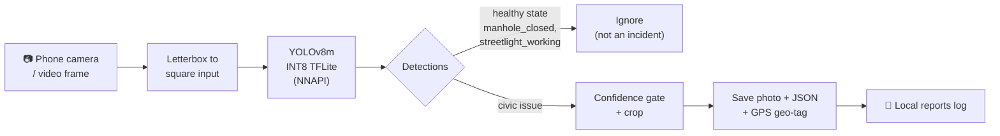

The detector **letterboxes** frames to the model's square input, matching how the model
was trained (stretching instead distorts every object and costs accuracy). Inference runs
through the **NNAPI** delegate for low latency. `manhole_closed` and `streetlight_working`
are healthy states — detected on purpose, then deliberately **not** reported.

---

## Classes

| | | | | |
|:--:|:--:|:--:|:--:|:--:|
| <br>**garbage_pile** | 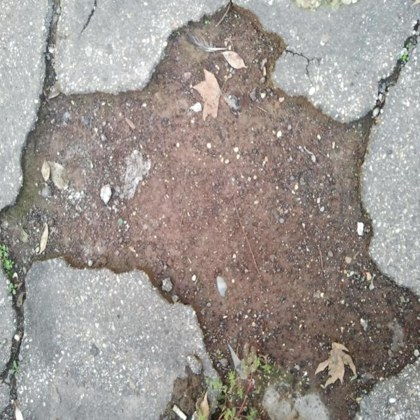<br>**pothole** | 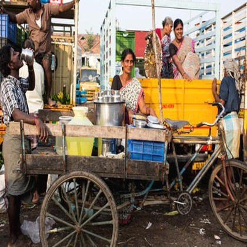<br>**encroachment** | 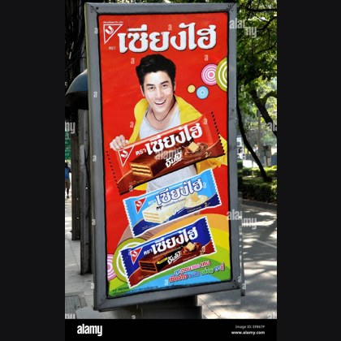<br>**billboard_hoarding** | 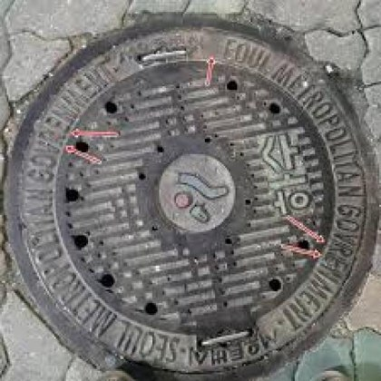<br>**manhole_closed** |
| 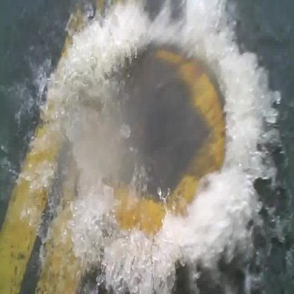<br>**manhole_open** | 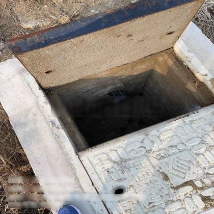<br>**manhole_broken** | 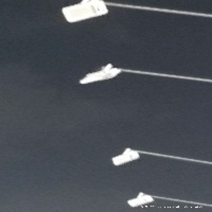<br>**streetlight_working** | 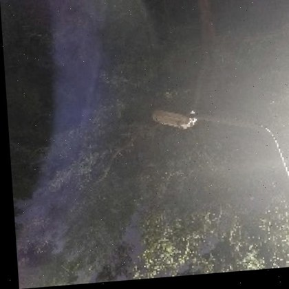<br>**streetlight_not_working** | 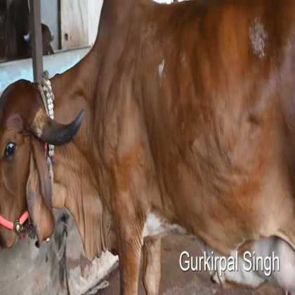<br>**animal** |

---

## Results

| metric | score |
|---|:---:|
| **mAP@50** | **0.80** |
| **mAP@50-95** | **0.70** |

Trained on a **17,000+ image** dataset with YOLOv8m, then exported to INT8 TFLite for
on-device inference.

---

## Mobile app interface

| Landing | Live detection | Reports |
|:--:|:--:|:--:|
| 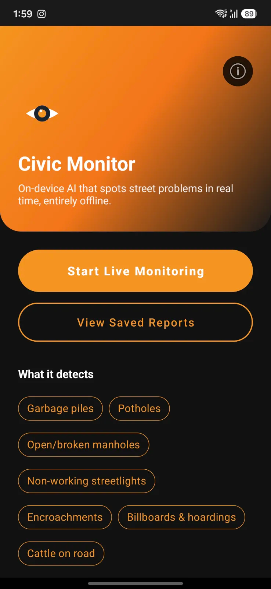 | 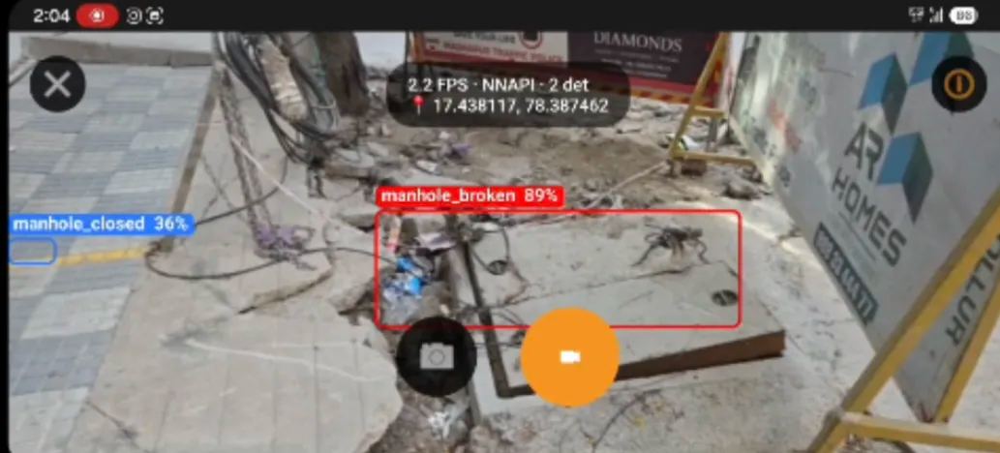 | 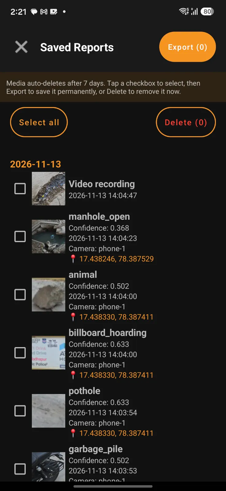 |

Kotlin · CameraX + TFLite · fully offline · live GPS geo-tagging.

### Demo

<video src="https://raw.githubusercontent.com/PrinceVerma04/Civic-monitor/main/docs/videos/working_demo.mp4" controls muted width="720"></video>

▶ [Watch the demo video](docs/videos/working_demo.mp4) (if the player above does not load)

---

## Run

```python
# detector (Python)
from ultralytics import YOLO
model = YOLO("weights/best.pt")
model.predict("street.jpg", conf=0.35, save=True)
```

```bash
# Android app
cd android_app && ./gradlew assembleDebug
adb install -r app/build/outputs/apk/debug/app-debug.apk
```

---

## Licence

Code released under the MIT Licence.
